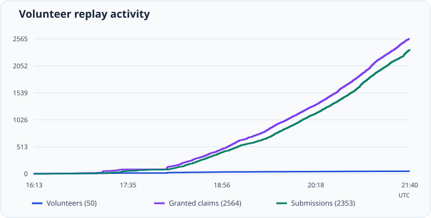

# Independent replay of Alpöge’s RH release

Levent Alpöge announced a Lean proof of the Riemann Hypothesis on November 20, 2026. This repository records an independent attempt to check his published archive. Credit for the claimed proof belongs to Alpöge and his collaborators. [Original announcement](https://alpo.ge/remark.pdf)

## Current status

**Full replay in progress.** No full RH verification receipt has been produced by this project. The [two-worker pilot](evidence/pilot-receipt.json) transferred 150 previously unbuilt modules; the primary reused them and kernel-checked one downstream module.

Current cloud progress is recorded in the [worker status report](STATUS.md). See the [live progress dashboard](https://rohanarun.github.io/alpoge-rh-replay/) for the module ledger breakdown.

## Contributors

Choose any of **175,187 module tasks** or one of **2,858 work packets**. Each module has a source digest, direct dependencies, import depth, and a coordinator snapshot state. Use the [contributor guide](CONTRIBUTING.md) to find an available packet, claim it, build it, and return evidence. Browse the [packet index](tracker/packets.tsv), [snapshot totals](tracker/summary.json), or [open volunteer claims](https://github.com/rohanarun/alpoge-rh-replay/issues?q=is%3Aissue%20is%3Aopen%20in%3Atitle%20Claim).

Start with the [agent instructions](auto-research.md) to claim work and submit replay evidence. Start your evidence comment with `Replay submission` to be credited automatically. Maintainers review the evidence before marking a task complete.

Working on a new Lean proof? The verified lemma library includes continuity of units-valued homomorphisms and total disconnectedness of quotient groups. [Import and use the lemmas](examples/proof-reuse/README.md#use-the-lemmas)

<!-- volunteer-roster-start -->

**Replay volunteers (93)**

[@123454321bobbob-tech](https://github.com/123454321bobbob-tech), [@21Z121Z1](https://github.com/21Z121Z1), [@aapolipponen](https://github.com/aapolipponen), [@agi-for-my-llama](https://github.com/agi-for-my-llama), [@Amahane-Hikari](https://github.com/Amahane-Hikari), [@amrehan](https://github.com/amrehan), [@ANdATIon](https://github.com/ANdATIon), [@angusbarry](https://github.com/angusbarry), [@arxhr007](https://github.com/arxhr007), [@aulafy](https://github.com/aulafy), [@BenCaunt](https://github.com/BenCaunt), [@BouquetAntoine](https://github.com/BouquetAntoine), [@Brendon-Hablutzel](https://github.com/Brendon-Hablutzel), [@burbon](https://github.com/burbon), [@ChristosMaglaras](https://github.com/ChristosMaglaras), [@chriswilson413](https://github.com/chriswilson413), [@CubeJerry](https://github.com/CubeJerry), [@DanieleCorso](https://github.com/DanieleCorso), [@dga471](https://github.com/dga471), [@dgahelper](https://github.com/dgahelper), [@dh5at](https://github.com/dh5at), [@dhudakk](https://github.com/dhudakk), [@drew2apps](https://github.com/drew2apps), [@EF-Code](https://github.com/EF-Code), [@egergerfg](https://github.com/egergerfg), [@emsi](https://github.com/emsi), [@Ethan-prog-netizen](https://github.com/Ethan-prog-netizen), [@florianmodel](https://github.com/florianmodel), [@gabeldev](https://github.com/gabeldev), [@galakurpi](https://github.com/galakurpi), [@Genius-Cai-wen-zheng](https://github.com/Genius-Cai-wen-zheng), [@gilad12-coder](https://github.com/gilad12-coder), [@gniax](https://github.com/gniax), [@HaqtanEfe](https://github.com/HaqtanEfe), [@hipotures](https://github.com/hipotures), [@iAndyHD3](https://github.com/iAndyHD3), [@JamCh01](https://github.com/JamCh01), [@JanSimeonMetzger](https://github.com/JanSimeonMetzger), [@jaykobdetar](https://github.com/jaykobdetar), [@jdenwood](https://github.com/jdenwood), [@jjjhenriksen](https://github.com/jjjhenriksen), [@jsnider3](https://github.com/jsnider3), [@juanfers1](https://github.com/juanfers1), [@jwr404](https://github.com/jwr404), [@krisyotam](https://github.com/krisyotam), [@ljagiello](https://github.com/ljagiello), [@loremcdmx](https://github.com/loremcdmx), [@Lv-00-ANI](https://github.com/Lv-00-ANI), [@m4tthewdavis](https://github.com/m4tthewdavis), [@mabdelazim](https://github.com/mabdelazim), [@maddoxjack](https://github.com/maddoxjack), [@matan1905](https://github.com/matan1905), [@maxime-fleury](https://github.com/maxime-fleury), [@mdpmcc](https://github.com/mdpmcc), [@misuadn-laplace](https://github.com/misuadn-laplace), [@MLEARNER701](https://github.com/MLEARNER701), [@MLTQ](https://github.com/MLTQ), [@mu-mei](https://github.com/mu-mei), [@Mzzj114](https://github.com/Mzzj114), [@nicu-chiciuc](https://github.com/nicu-chiciuc), [@Paulee314](https://github.com/Paulee314), [@rahulsundar477-star](https://github.com/rahulsundar477-star), [@rayy3535](https://github.com/rayy3535), [@RhizoNymph](https://github.com/RhizoNymph), [@rishabh-16](https://github.com/rishabh-16), [@RobertBarnettProjects](https://github.com/RobertBarnettProjects), [@roonastgames](https://github.com/roonastgames), [@sat3n](https://github.com/sat3n), [@Scratch-net](https://github.com/Scratch-net), [@SeriousRising](https://github.com/SeriousRising), [@Sethumathavanpk](https://github.com/Sethumathavanpk), [@shardmods](https://github.com/shardmods), [@Sigomi](https://github.com/Sigomi), [@sp20262026](https://github.com/sp20262026), [@surfyhou](https://github.com/surfyhou), [@t-choudhury](https://github.com/t-choudhury), [@TomMoeras](https://github.com/TomMoeras), [@TOTOGT](https://github.com/TOTOGT), [@Trefoiler](https://github.com/Trefoiler), [@TVSuchty](https://github.com/TVSuchty), [@twaldin](https://github.com/twaldin), [@unhingedpanda](https://github.com/unhingedpanda), [@UnityChaos](https://github.com/UnityChaos), [@user42245](https://github.com/user42245), [@varo6](https://github.com/varo6), [@vivekshivarajkumar](https://github.com/vivekshivarajkumar), [@walkingsophie](https://github.com/walkingsophie), [@whitegrave1917-web](https://github.com/whitegrave1917-web), [@WilmervH](https://github.com/WilmervH), [@WorldianAI](https://github.com/WorldianAI), [@Wronskode](https://github.com/Wronskode), [@yingluom](https://github.com/yingluom), [@zediir](https://github.com/zediir)

<!-- volunteer-roster-end -->

[Code contributors](https://github.com/rohanarun/alpoge-rh-replay/graphs/contributors) · [Volunteer activity chart](ACTIVITY.md)

### Active claims awaiting evidence

[Browse open granted claims on GitHub](https://github.com/rohanarun/alpoge-rh-replay/issues?q=is%3Aissue+is%3Aopen+label%3Aclaim-granted).

<details>
<summary>Show active claims awaiting evidence</summary>

<!-- active-volunteers-start -->

[1,098 entries. View the full table](tracker/volunteer-tables/active/README.md).

| Contributor | Task | Status |
|---|---|---|
| [@BouquetAntoine](https://github.com/BouquetAntoine) | [M003659](https://github.com/rohanarun/alpoge-rh-replay/issues/14334) | Claimed |
| [@BouquetAntoine](https://github.com/BouquetAntoine) | [M028801](https://github.com/rohanarun/alpoge-rh-replay/issues/14335) | Claimed |
| [@BouquetAntoine](https://github.com/BouquetAntoine) | [M002781](https://github.com/rohanarun/alpoge-rh-replay/issues/14336) | Claimed |
| [@gilad12-coder](https://github.com/gilad12-coder) | [M139051](https://github.com/rohanarun/alpoge-rh-replay/issues/14342) | Claimed |
| [@hipotures](https://github.com/hipotures) | [P2071](https://github.com/rohanarun/alpoge-rh-replay/issues/14348) | Claimed |
| [@galakurpi](https://github.com/galakurpi) | [M161824](https://github.com/rohanarun/alpoge-rh-replay/issues/14402) | Claimed |
| [@galakurpi](https://github.com/galakurpi) | [M171107](https://github.com/rohanarun/alpoge-rh-replay/issues/14404) | Claimed |
| [@TomMoeras](https://github.com/TomMoeras) | [P2156](https://github.com/rohanarun/alpoge-rh-replay/issues/14406) | Claimed |
| [@galakurpi](https://github.com/galakurpi) | [M120231](https://github.com/rohanarun/alpoge-rh-replay/issues/14407) | Claimed |
| [@galakurpi](https://github.com/galakurpi) | [M042326](https://github.com/rohanarun/alpoge-rh-replay/issues/14408) | Claimed |
| [@galakurpi](https://github.com/galakurpi) | [M171166](https://github.com/rohanarun/alpoge-rh-replay/issues/14409) | Claimed |
| [@galakurpi](https://github.com/galakurpi) | [M171178](https://github.com/rohanarun/alpoge-rh-replay/issues/14410) | Claimed |
| [@galakurpi](https://github.com/galakurpi) | [M171142](https://github.com/rohanarun/alpoge-rh-replay/issues/14412) | Claimed |
| [@galakurpi](https://github.com/galakurpi) | [M171105](https://github.com/rohanarun/alpoge-rh-replay/issues/14413) | Claimed |
| [@galakurpi](https://github.com/galakurpi) | [M155478](https://github.com/rohanarun/alpoge-rh-replay/issues/14415) | Claimed |
| [@galakurpi](https://github.com/galakurpi) | [M173758](https://github.com/rohanarun/alpoge-rh-replay/issues/14416) | Claimed |
| [@galakurpi](https://github.com/galakurpi) | [M171144](https://github.com/rohanarun/alpoge-rh-replay/issues/14417) | Claimed |
| [@galakurpi](https://github.com/galakurpi) | [M171145](https://github.com/rohanarun/alpoge-rh-replay/issues/14418) | Claimed |
| [@RhizoNymph](https://github.com/RhizoNymph) | [P2534](https://github.com/rohanarun/alpoge-rh-replay/issues/14420) | Claimed |
| [@vivekshivarajkumar](https://github.com/vivekshivarajkumar) | [M039409](https://github.com/rohanarun/alpoge-rh-replay/issues/14427) | Claimed |

<!-- active-volunteers-end -->

</details>

<details>
<summary>Submitted for review</summary>

<!-- pending-volunteers-start -->

[6,471 entries. View the full table](tracker/volunteer-tables/pending/README.md).

| Contributor | Task | Review |
|---|---|---|
| [@galakurpi](https://github.com/galakurpi) | [M171136](https://github.com/rohanarun/alpoge-rh-replay/issues/14393#issuecomment-7058262273) | Pending review |
| [@galakurpi](https://github.com/galakurpi) | [M171113](https://github.com/rohanarun/alpoge-rh-replay/issues/14394#issuecomment-7058263452) | Pending review |
| [@ANdATIon](https://github.com/ANdATIon) | [M107375](https://github.com/rohanarun/alpoge-rh-replay/issues/14395#issuecomment-7058233138) | Pending review |
| [@galakurpi](https://github.com/galakurpi) | [M171125](https://github.com/rohanarun/alpoge-rh-replay/issues/14396#issuecomment-7058264662) | Pending review |
| [@ANdATIon](https://github.com/ANdATIon) | [M062155](https://github.com/rohanarun/alpoge-rh-replay/issues/14397#issuecomment-7058235673) | Pending review |
| [@galakurpi](https://github.com/galakurpi) | [M161823](https://github.com/rohanarun/alpoge-rh-replay/issues/14398#issuecomment-7058265815) | Pending review |
| [@ANdATIon](https://github.com/ANdATIon) | [M154907](https://github.com/rohanarun/alpoge-rh-replay/issues/14399#issuecomment-7058238121) | Pending review |
| [@ANdATIon](https://github.com/ANdATIon) | [M171114](https://github.com/rohanarun/alpoge-rh-replay/issues/14400#issuecomment-7058235468) | Pending review |
| [@galakurpi](https://github.com/galakurpi) | [M171115](https://github.com/rohanarun/alpoge-rh-replay/issues/14401#issuecomment-7058266902) | Pending review |
| [@ANdATIon](https://github.com/ANdATIon) | [M074704](https://github.com/rohanarun/alpoge-rh-replay/issues/14403#issuecomment-7058235764) | Pending review |
| [@ANdATIon](https://github.com/ANdATIon) | [M171571](https://github.com/rohanarun/alpoge-rh-replay/issues/14405#issuecomment-7058237005) | Pending review |
| [@Amahane-Hikari](https://github.com/Amahane-Hikari) | [M033468](https://github.com/rohanarun/alpoge-rh-replay/issues/14411#issuecomment-7058246413) | Pending review |
| [@Amahane-Hikari](https://github.com/Amahane-Hikari) | [M121003](https://github.com/rohanarun/alpoge-rh-replay/issues/14414#issuecomment-7058246057) | Pending review |
| [@ANdATIon](https://github.com/ANdATIon) | [M055443](https://github.com/rohanarun/alpoge-rh-replay/issues/14419#issuecomment-7058242808) | Pending review |
| [@ANdATIon](https://github.com/ANdATIon) | [M171150](https://github.com/rohanarun/alpoge-rh-replay/issues/14421#issuecomment-7058240558) | Pending review |
| [@ANdATIon](https://github.com/ANdATIon) | [M120506](https://github.com/rohanarun/alpoge-rh-replay/issues/14422#issuecomment-7058244533) | Pending review |
| [@ANdATIon](https://github.com/ANdATIon) | [M107371](https://github.com/rohanarun/alpoge-rh-replay/issues/14423#issuecomment-7058242587) | Pending review |
| [@ANdATIon](https://github.com/ANdATIon) | [M171570](https://github.com/rohanarun/alpoge-rh-replay/issues/14424#issuecomment-7058242056) | Pending review |
| [@ANdATIon](https://github.com/ANdATIon) | [M127375](https://github.com/rohanarun/alpoge-rh-replay/issues/14425#issuecomment-7058242563) | Pending review |
| [@Amahane-Hikari](https://github.com/Amahane-Hikari) | [M039244](https://github.com/rohanarun/alpoge-rh-replay/issues/14426#issuecomment-7058248326) | Pending review |

<!-- pending-volunteers-end -->

</details>

<details>
<summary>Reviewed builds</summary>

<!-- volunteers-start -->

[9,244 entries. View the full table](tracker/volunteer-tables/reviewed/README.md).

| Contributor | Task | Modules | Review |
|---|---|---:|---|
| [@galakurpi](https://github.com/galakurpi) | [M001876](https://github.com/rohanarun/alpoge-rh-replay/issues/12357#issuecomment-7057082719) | 1 | [Build evidence verified](evidence/volunteers/M001876.json) |
| [@loremcdmx](https://github.com/loremcdmx) | [M149266](https://github.com/rohanarun/alpoge-rh-replay/issues/12431#issuecomment-7057151749) | 1 | [Build evidence verified](evidence/volunteers/M149266.json) |
| [@rayy3535](https://github.com/rayy3535) | [M051879](https://github.com/rohanarun/alpoge-rh-replay/issues/11617#issuecomment-7056406367) | 1 | [Build evidence verified](evidence/volunteers/M051879.json) |
| [@loremcdmx](https://github.com/loremcdmx) | [M002730](https://github.com/rohanarun/alpoge-rh-replay/issues/11950#issuecomment-7056801825) | 1 | [Build evidence verified](evidence/volunteers/M002730.json) |
| [@loremcdmx](https://github.com/loremcdmx) | [M002683](https://github.com/rohanarun/alpoge-rh-replay/issues/12542#issuecomment-7057243379) | 1 | [Build evidence verified](evidence/volunteers/M002683.json) |
| [@loremcdmx](https://github.com/loremcdmx) | [M078852](https://github.com/rohanarun/alpoge-rh-replay/issues/12283#issuecomment-7056997744) | 1 | [Build evidence verified](evidence/volunteers/M078852.json) |
| [@SeriousRising](https://github.com/SeriousRising) | [P2005](https://github.com/rohanarun/alpoge-rh-replay/issues/8101#issuecomment-7055621828) | 64 | [Build evidence verified](evidence/volunteers/P2005.json) |
| [@rayy3535](https://github.com/rayy3535) | [M045997](https://github.com/rohanarun/alpoge-rh-replay/issues/11913#issuecomment-7056767665) | 1 | [Build evidence verified](evidence/volunteers/M045997.json) |
| [@loremcdmx](https://github.com/loremcdmx) | [M062763](https://github.com/rohanarun/alpoge-rh-replay/issues/12468#issuecomment-7057158480) | 1 | [Build evidence verified](evidence/volunteers/M062763.json) |
| [@loremcdmx](https://github.com/loremcdmx) | [M092125](https://github.com/rohanarun/alpoge-rh-replay/issues/12505#issuecomment-7057224293) | 1 | [Build evidence verified](evidence/volunteers/M092125.json) |
| [@hipotures](https://github.com/hipotures) | [P1843](https://github.com/rohanarun/alpoge-rh-replay/issues/9989#issuecomment-7055506851) | 64 | [Build evidence verified](evidence/volunteers/P1843.json) |
| [@emsi](https://github.com/emsi) | [P2124](https://github.com/rohanarun/alpoge-rh-replay/issues/11062#issuecomment-7056513548) | 64 | [Build evidence verified](evidence/volunteers/P2124.json) |
| [@TOTOGT](https://github.com/TOTOGT) | [M161838](https://github.com/rohanarun/alpoge-rh-replay/issues/8776#issuecomment-7056830895) | 1 | [Build evidence verified](evidence/volunteers/M161838.json) |
| [@TOTOGT](https://github.com/TOTOGT) | [M162132](https://github.com/rohanarun/alpoge-rh-replay/issues/9061#issuecomment-7056833782) | 1 | [Build evidence verified](evidence/volunteers/M162132.json) |
| [@TOTOGT](https://github.com/TOTOGT) | [M162286](https://github.com/rohanarun/alpoge-rh-replay/issues/9133#issuecomment-7056839535) | 1 | [Build evidence verified](evidence/volunteers/M162286.json) |
| [@TOTOGT](https://github.com/TOTOGT) | [M162273](https://github.com/rohanarun/alpoge-rh-replay/issues/9126#issuecomment-7056837357) | 1 | [Build evidence verified](evidence/volunteers/M162273.json) |
| [@TOTOGT](https://github.com/TOTOGT) | [M175177](https://github.com/rohanarun/alpoge-rh-replay/issues/9881#issuecomment-7056846168) | 1 | [Build evidence verified](evidence/volunteers/M175177.json) |
| [@dhudakk](https://github.com/dhudakk) | [M095926](https://github.com/rohanarun/alpoge-rh-replay/issues/9987#issuecomment-7055266206) | 1 | [Build evidence verified](evidence/volunteers/M095926.json) |
| [@dhudakk](https://github.com/dhudakk) | [M038730](https://github.com/rohanarun/alpoge-rh-replay/issues/11207#issuecomment-7056203684) | 1 | [Build evidence verified](evidence/volunteers/M038730.json) |
| [@TOTOGT](https://github.com/TOTOGT) | [M006315](https://github.com/rohanarun/alpoge-rh-replay/issues/10130#issuecomment-7056851432) | 1 | [Build evidence verified](evidence/volunteers/M006315.json) |

<!-- volunteers-end -->

</details>

## Completed parts

<!-- completed-start -->

| Evidence for distinct module IDs | Count |
|---|---:|
| Successful source build observed | 18,469 |
| Pilot proof object reused | 150 |
| Pilot downstream module kernel-checked | 1 |
| Distributed proof object reused | 16,970 |
| Volunteer build evidence reviewed | 33,299 |
| Worker target kernel replay reviewed | 99 |
| **Total with recorded module evidence** | **68,988 / 175,187** |

[See each completed part and its evidence](completed/README.md) · [Machine-readable ledger](tracker/completed.tsv)

<!-- completed-end -->

## Give this prompt to an agent

> Help independently replay the claimed RH proof using https://github.com/rohanarun/alpoge-rh-replay. Read auto-research.md and fast-forward to the latest main commit. Use `python3 tracker/tasks.py next` to find a fully open shallow packet of up to 64 modules. Prefer a packet if its import depth and your resources make it feasible. On a cold or constrained worker, start with one target from `next --cold`. For a partial packet, choose an open module and claim it individually.
>
> Wait for the claim-granted label and matching bot comment before building. Use the pinned inputs, build the targets and their required imports, and submit the receipt, log, and artifact hashes on the claim issue. Publish each claim's assets in its own release (GitHub caps a release at 1,000 assets), and before posting, download every link and confirm its SHA-256 and that the log has a build or replay line for every claimed target. Keep submitted claims open for review. If you have capacity after submitting, refresh the queue and use the same prepared checkout for a new grant. Release claims you abandon. Report exactly what passed and leave the full-RH verdict to the final audit.

[Full instructions for agents](auto-research.md) · [Claims and conflicts](https://github.com/rohanarun/alpoge-rh-replay/issues?q=is%3Aissue+is%3Aopen+in%3Atitle+Claim)

## Reproduce the check

On Linux, install the elan launcher and ensure its `lean` and `lake` commands are on your PATH. The script also requires Bash, Git, curl, GNU tar, sha256sum, a C toolchain, network access, and a large writable build volume. Run from this repository with a fresh output directory.

```bash
./verify.sh /path/to/empty/replay-directory
```

The script compares every archive part with its SHA-256 digest, checks the toolchain and mathlib revision, builds the final module from source, and writes the transcript to `replay.log` in the output directory. The pinned Lean compiler is 4.33.1 and the mathlib commit is `0df444a360eaa60ab8c11dca51a86af692955474`.

### Integrity checkpoints

The script re-verifies what it depends on at each stage, so archive code that runs during preparation and the build cannot silently replace the tools or records that judge its output. In execution order:

1. **Archive verification.** Every downloaded archive part is checked against `parts.sha256` with `sha256sum -c`. The SHA-256 digests of `Audit.lean` and `parts.sha256` are recorded before any archive code runs.
2. **Manifest pin.** Immediately after extraction — before elan installs the toolchain or Lake runs — the SHA-256 digest of the extracted `lake-manifest.json` is recorded.
3. **Toolchain integrity.** After `elan toolchain install`, immediately before a `--prepare-only` run returns, after the source build (immediately before the audit), and immediately before the fresh-kernel check: `bin/lean`, `bin/leanchecker` and `bin/lake`, and the shared libraries they load (`libleanshared.so`, `libLake_shared.so`, `libleanshared_1.so`, `libleanshared_2.so`, `libInit_shared.so`), still match the digests pinned in `verify.sh` from the official Lean 4.33.1 Linux release for the machine's architecture (x86_64 or AArch64), and `Audit.lean` and `parts.sha256` still match the digests recorded at step 1. Prints `REPLAY_INTEGRITY_CHECK_PASSED`.
4. **Dependency check.** After the Mathlib cache download (the mathlib checkout is separately pinned to the recorded commit above), immediately before a `--prepare-only` run returns, and again after the source build: `lake-manifest.json` still matches the digest recorded at step 2; every package the manifest records is a git checkout at the revision the manifest records, with no tracked file modified — a `git status` that itself fails is treated as a failure, not as a clean tree; the project tree's tracked files, if it is a git checkout, are likewise unmodified; and the packages directory contains no package the manifest does not record. Prints `REPLAY_DEPENDENCIES_PRISTINE_PASSED`.

## Read the evidence

1. `REPLAY_SOURCE_BUILD_PASSED` means Lake built the module containing the final theorem.
2. `REPLAY_AXIOM_AUDIT_PASSED` means the five public theorems in `Main` type-checked against their statements, which `Audit.lean` writes out with Mathlib definitions only. The audit rejects any reported axiom beyond propositional extensionality, classical choice, and quotient soundness.
3. `REPLAY_FRESH_KERNEL_PASSED` means Lean’s checker replayed the declarations imported by `Main` in a fresh environment. It uses the same Lean kernel implementation.

The script prints two further markers. `REPLAY_DEPENDENCIES_PRISTINE_PASSED` means every package recorded in `lake-manifest.json` is checked out at its recorded revision with no tracked file modified. `REPLAY_INTEGRITY_CHECK_PASSED` is printed after the toolchain is installed and again immediately before the audit and fresh-kernel stages: the `lean`, `leanchecker` and `lake` binaries and the shared libraries they load (including `libleanshared.so`, which contains the kernel) still match the digests pinned in `verify.sh` from the official Lean 4.33.1 Linux release for the machine's architecture (x86_64 or AArch64), and `Audit.lean` and `parts.sha256` are unchanged since the archive was verified, so code executed during the build cannot silently replace the tools or statements that judge its output.

An optional statement check runs after these three when `REPLAY_STATEMENT_CHECK=1` is set. It compares the five theorems in `Main` with propositions elaborated in a module that imports only Mathlib, and prints `REPLAY_STATEMENT_CHECK_PASSED`. It can also be run against a completed checkout; see [audit/README.md](audit/README.md).

A completed report should include the exit status, all three outputs, the printed theorem and axioms, and a checksum for the archived transcript. A machine or storage failure leaves the mathematical claim unresolved.

## Optional determinant check

The [M115707 example](examples/M115707/README.md) compares a shorter local Gram determinant argument with the published module. This check runs separately from the volunteer replay.

## Volunteer activity



[How the chart is counted](ACTIVITY.md) · [Event data](tracker/activity.tsv)

## License

The original replay tooling and documentation in this repository are available under the [MIT License](LICENSE). Upstream Lean source, Mathlib, and third-party artifacts retain their respective licenses.
